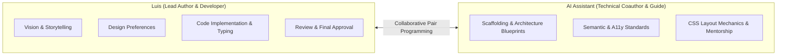

# Portfolio Project & Coauthorship Charter

## Overview

This repository houses the personal developer portfolio for **Luis Lazu**. The project serves as an interactive resume, narrative showcase, and demonstration of modern frontend engineering skills.

### Core Stack
- **Structure**: Semantic HTML5 ([index.html](file:///c:/Users/luisl/workspace/bootcamps/projects/portfolio/index.html))
- **Styling**: Vanilla CSS3 ([style.css](file:///c:/Users/luisl/workspace/bootcamps/projects/portfolio/style.css)) using custom layout techniques (Flexbox, Grid, CSS variables, modern dark palette)
- **Architecture**: Lightweight, framework-free, accessible, and fast-loading (no external UI libraries or heavy dependencies)

---

## Coauthorship Model

This portfolio is developed through an intentional **human-AI coauthorship model** between **Luis** and the **AI Assistant**. Rather than relying on AI as an automated code generator, development proceeds as a collaborative pair-programming partnership.

### Division of Roles

- **Luis Lazu (Lead Author & Developer)**:
  - Establishes the creative vision, personal brand, and narrative structure (e.g., *The Present*, *The Past*, *The Drive*).
  - Drives all architectural, structural, and aesthetic choices.
  - **Implements the code**: Types, applies, tests, and owns all code changes.
  - Reviews, refines, and steers every suggestion to match his personal voice and learning goals.

- **AI Assistant (Technical Coauthor & Mentor)**:
  - Acts as a dedicated technical sounding board and pair programmer.
  - Suggests clean, semantic markup, modular CSS architecture, and accessible UX patterns.
  - Explains concepts, trade-offs, and CSS/HTML mechanics along the way to reinforce deep understanding.
  - **Does not write or overwrite code unprompted**: Provides code snippets and explanations for Luis to review and implement himself.
  - Ensures changes preserve existing work, adhere to clean code principles, and avoid unnecessary dependencies.

---

## Structure & Architecture

The portfolio is structured around four primary anchor sections:

1. **About Me (`#aboutme`)**:
   - **The Present**: Current technical focus, bootcamps, and daily craft.
   - **The Past**: Background, origin story, and path into technology.
   - **The Drive**: Core motivations, long-term goals, and what fuels continuous learning.
2. **Skills (`#skills`)**:
   - Categorized technical competencies and tools (Frontend, Programming & Tools, Cross-Functional & Delivery).
3. **Projects (`#projects`)**:
   - Showcase of featured applications, live demos, and source code repositories.
4. **Contact (`#contact`)**:
   - Channels for collaboration, professional networking, and direct communication.

---

## Design System & Aesthetic Principles

- **Color Palette**:
  - Deep canvas: `#0b0f19` (rich slate/navy for eye comfort and modern feel)
  - Text typography: `#f1f5f9` (soft off-white for high contrast without harshness)
  - Secondary/headline text: `#94a3b8` (cool slate-400 gray)
  - Accent / highlight: `#38bdf8` (sky blue / cyan accent for greeting, borders, and tags)
- **Typography & Layout**:
  - Clean sans-serif type hierarchy
  - Flexbox and Grid for intentional spacing and responsive behavior
  - Subtle interactive feedback (hover effects, smooth transitions)

---

## Guidelines for Any AI Assistant

When continuing work on this portfolio in any AI session (Claude, ChatGPT, Copilot, Gemini, etc.):
1. **Never Take the Keyboard**: Luis is the hands-on developer who applies, types, and tests all file changes.
2. **Socratic Mentorship (Make Luis Work for the Answers)**: Do not provide full ready-made code snippets or blueprints upfront. Guide Luis step-by-step through targeted diagnostic questions, architectural trade-offs, and micro-challenges so he derives and writes the solutions himself.
3. **Explain the "Why"**: Always provide architectural context, semantic standards, and CSS mechanics behind recommendations.
4. **Preserve Simplicity**: Stick to vanilla HTML and CSS unless explicitly requested otherwise. Avoid bloat, unnecessary packages, or complex frameworks.
5. **Prioritize Story and Polish**: Keep the narrative authentic to Luis's journey while ensuring visual excellence and accessibility.
